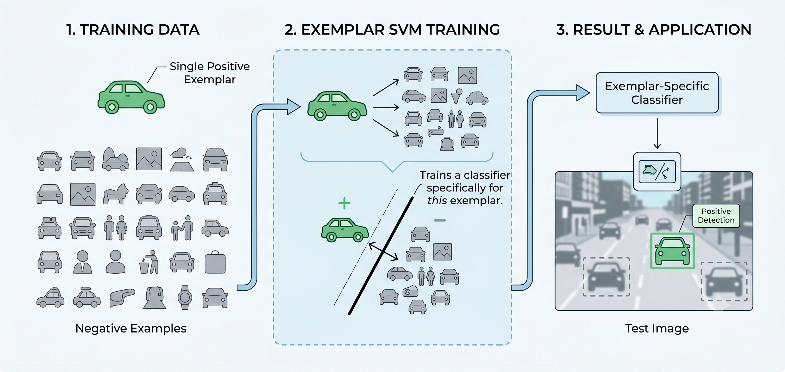

<details open>
  <summary><b>Table of Contents</b></summary>

- [I. Where kNN Falls Short](#i-where-knn-falls-short)
- [II. What is an Exemplar SVM?](#ii-what-is-an-exemplar-svm)
  - [The Shift in Thinking](#the-shift-in-thinking)
- [III. Under the Hood](#iii-under-the-hood)
- [IV. Hands-on Implementation](#iv-hands-on-implementation)
  - [Step 1: Build the On-the-Fly Dataset](#step-1-build-the-on-the-fly-dataset)
  - [Step 2: Train the Mini-Model](#step-2-train-the-mini-model)
  - [Step 3: `predict()` vs `decision_function()`](#step-3-predict-vs-decision_function)
  - [Step 4: Rank the Results](#step-4-rank-the-results)
- [V. Superpowers and Edge Cases](#v-superpowers-and-edge-cases)
  - [Hold on! You said we train a new model for each query?](#hold-on-you-said-we-train-a-new-model-for-each-query)
  - [Handling Multiple Queries at Once](#handling-multiple-queries-at-once)
  - [The "Shared Concept" Trick](#the-shared-concept-trick)

</details>

I came across a tweet by Andrej Karpathy that made me stop and think:

<blockquote class="twitter-tweet" data-theme="dark" data-dnt="true" align="center"><p lang="en" dir="ltr">Random note on k-Nearest Neighbor lookups on embeddings: in my experience much better results can be obtained by training SVMs instead. Not too widely known.<br><br>Short example:<a href="https://t.co/RXO9xiOmAB">https://t.co/RXO9xiOmAB</a><br><br>Works because SVM ranking considers the unique aspects of your query w.r.t. data.</p>&mdash; Andrej Karpathy (@karpathy) <a href="https://x.com/karpathy/status/1647025230546886658?ref_src=twsrc%5Etfw">April 14, 2023</a></blockquote>
<script async src="https://platform.x.com/widgets.js" charset="utf-8"></script>

My first thoughts were: What does he mean by training SVMs for embedding lookups? Why would you train a model just to perform a search? The results are better in what sense? And, most importantly, why does this idea work?

Embedding lookups usually follow the following pipeline. You embed your data, put it into an index like FAISS, and every time you have a new embedding (the query) that you want to find the most similar embedding to it in the index, you run a standard k-Nearest Neighbors (kNN) search. It's intuitive, and the standard.

But reading through the replies, someone linked [a 2011 computer vision paper](https://www.cs.cmu.edu/~tmalisie/projects/iccv11/) that explains the trick. It’s a technique called the **Exemplar SVM**.

Instead of treating your search query as just another point in space to measure distance from, you use it to train a disposable, single-use classifier on the fly. It takes a little more compute, but it changes how we measure similarity, yielding cleaner and more semantically relevant results than a basic kNN.

In this blog post, we'll explore why this technique works so well, using examples in the context of similar document retrieval, and show how you can implement it in just a few lines of code

# I. Where kNN Falls Short

To understand why this SVM trick is so useful, we first need to look at how we normally search through embeddings.

Usually, if you want to find similar documents, you rely on a k-Nearest Neighbors (kNN) search. You embed your text, load the vectors into a fast index using a library like FAISS, and when a query comes in, the system calculates the geometric distance between your query and everything in the index.


It works well most of the time, but it has a fundamental characteristic that kNN’s accuracy relies heavily on the embedding model's ability to distill the precise semantic intent from everything else.

Let's say your embeddings have 1,536 dimensions. When a standard kNN algorithm calculates similarity, it gives all 1,536 of those dimensions the exact same mathematical weight.  The problem is that the values across those dimensions don't solely represent the "core semantic meaning". They also encode things like common phrasing, standard document formatting, or basic sentence structure that appear in almost every text. Because kNN is just calculating raw math, it relies entirely on the embedding model to emphasize the right signals. If the model allows this generic background noise to dominate the vector's magnitudes, kNN will blindly measure it. It might rank a document highly simply because it mathematically matches a massive volume of this generic background noise, completely missing the actual semantic heart of your query.

# II. What is an Exemplar SVM?

To fix the shortcoming of kNN, we have to fundamentally change how we think about a search query. This brings us to the "Exemplar" SVM.

In plain English, an exemplar is a perfect, highly specific example of something. If you want to teach someone what a "sports car" is, you could give them a list of abstract rules; two doors, fast, aerodynamic. Alternatively, you could just point to a specific red Porsche 911 and say, **"Look at this. Compare everything else to this."** The Porsche is your exemplar.

 on [Unsplash](https://unsplash.com/photos/a-white-race-car-speeds-around-a-track-5M_GM_9fg9Y?utm_source=unsplash&utm_medium=referral&utm_content=creditCopyText)")

Normally, Support Vector Machines (SVMs) are used to learn broad categories. You feed a model hundreds of documents about "Machine Learning" (positive examples) and hundreds of random documents (negative examples), and it learns a general boundary between the two.

An Exemplar SVM works little differently. In this setup:

- You have exactly **one** positive example: your single search query.
- You have thousands of negative examples: the rest of the documents in your database.

Instead of trying to learn a broad category, the SVM's only job is to look at your single query and figure out exactly "what makes it unique compared to the rest of your dataset".



## The Shift in Thinking

This requires a change in how we view the database itself:

- **The kNN Way:** Your data sits in a pre-built spatial index. You drop a query in, and it calculates the geometric distances.
- **The SVM Way:** Your raw data is the index. For every single query that comes in, you train a brand new, disposable mini-model on the fly.

By forcing the SVM to draw a line between your query and the rest of the database, it actively learns the structure of your data. It looks at the generic background noise that kNN trips over, sees that those traits belong to the negative examples as well, and effectively gives them a weight of zero. It focuses entirely on the unique characteristics of your exemplar, giving you a much similar list of results (more semantically similar).

# III. Under the Hood

To understand how we actually rank the results without relying on a pre-built spatial tree, let's look at the underlying math. It is straightforward.

When you train your single-use SVM, it draws a flat boundary, called a hyperplane, to separate your positive query from the negative background data. The equation for this boundary is:

$$
w^T x + b = 0
$$

Here, $w$ is the weight vector (which sets the orientation of the boundary), $x$ is the data point (the embedding you are scoring), and $b$ is the bias.

When we evaluate a document against this boundary, we plug its embedding into the equation to get a raw score:

$$
f(x) = w^T x + b 
$$

This raw score is known as the functional margin. But to get the actual, physical Euclidean distance from a document to the boundary, we just divide that score by the magnitude (or length) of the weight vector:

$$
\frac{|w^T x + b|}{\|w\|} 
$$

The beautiful part is that the magnitude ($\|w\|$) is just a fixed, unchanging constant. This means the raw score the model outputs is strictly proportional to the true Euclidean distance.

The sign (+ or -) tells you which side of the line the document is on, and the number tells you how far away it is. By simply sorting these scores in descending order, you are elegantly ranking your entire database. The documents that fall deepest into your query's positive territory bubble right to the top.

 and the negative points (rest of points in your database). Generated using Nano Banana")

# IV. Hands-on Implementation

Let's translate this concept into actual Python code using `scikit-learn`.

Imagine we already have a database of 1,000 document embeddings, and we just generated a new embedding for our search query. Both are 1,536-dimensional vectors.

## Step 1: Build the On-the-Fly Dataset

First, we stack our query and our database together into a single array. Then, we create our labels: the query gets a `1` (positive), and the entire rest of the database gets a `0` (negative).

```python
import numpy as np
from sklearn import svm

# Assume 'embeddings' is our (1000, 1536) index and 'query' is our (1536,) search vector
# Combine the query and the index into one dataset
x = np.concatenate([query[None, ...], embeddings])

# Create the labels: 1 for the query, 0 for everything else
y = np.zeros(1001)
y[0] = 1
```

Having a single positive example and a thousand negatives might feel like a machine learning faux pas, but in the context of an Exemplar SVM, this extreme imbalance is exactly what we want.

## Step 2: Train the Mini-Model

Next, we spin up a Linear Support Vector Classifier and train it.

```python
# Initialize the Exemplar SVM
clf = svm.LinearSVC(class_weight='balanced', verbose=False, max_iter=10000, tol=1e-6, C=0.1)

# Train the model on the fly
clf.fit(x, y)
```

Notice two critical parameters here:

- `class_weight='balanced'`: Because we have one positive and a thousand negatives, this tells the SVM to heavily weight our single query so it doesn't get ignored.
- `C=0.1`: This is the regularization parameter. A value of `0.1` works great in practice because it prevents the model from obsessing over noisy data. If you have extremely clean, highly trusted embeddings, you can bump this up to `1.0` (less regularization, as the parameter `C` is inversely proportional to regularization).

## Step 3: `predict()` vs `decision_function()`

If this were a normal classification task, we would call `clf.predict(x)`. But `.predict()` only outputs hard labels—in this case, `1` or `0`.

Instead, we use `.decision_function(x)`. As we discussed in the math section, this skips the hard labels and returns the raw continuous score. It measures exactly how far each document sits from the boundary line.

## Step 4: Rank the Results

Now we just score the database, sort the results in descending order, and grab our top hits.

```python
# Score the dataset using the continuous decision function
similarities = clf.decision_function(x)

# Sort from highest score to lowest
sorted_ix = np.argsort(-similarities)

print("Top results:")
# Skip the 0th index if you don't want the query returning itself!
for k in sorted_ix[1:11]:
    print(f"Row {k - 1}, Similarity Score: {similarities[k]:.4f}")
```

And just like that, you have a semantically rich search ranking.

# V. Superpowers and Edge Cases

## Hold on! You said we train a new model for each query?

There is one elephant in the room: speed.

Libraries like FAISS are incredibly fast because they rely on pre-computed spatial indexes. But for our Exemplar-SVM, we train a new SVM model for each query. But Karpathy argues that the computational hit isn't much larger than KNN.

## Handling Multiple Queries at Once

One of the things that surprised me most about this approach is how gracefully it handles complex searches.

Suppose you want to find documents that combine two different concepts, say, an embedding for "Electric Batteries" and an embedding for "Cars."

In a standard kNN workflow, the common practice is to average the two vectors together and search for that midpoint. But averaging vectors dilutes their meaning. If one vector has a very strong signal for a specific feature and the other has a weak signal, averaging them waters down that important trait.

## The "Shared Concept" Trick

With an SVM, you don't average anything. You simply add both of your query vectors to your on-the-fly dataset and label them both as `1` (positive).

To draw a single boundary that separates **"both"** of your queries from the rest of the database, the SVM is forced to figure out exactly what those two examples have in common. It actively seeks out the intersection of features that makes them unique compared to the background.

Instead of searching for a diluted, generic midpoint, the SVM zeroes in on the shared concept, pulling up documents that strongly exhibit both traits, like articles specifically about EVs or hybrid engines.
