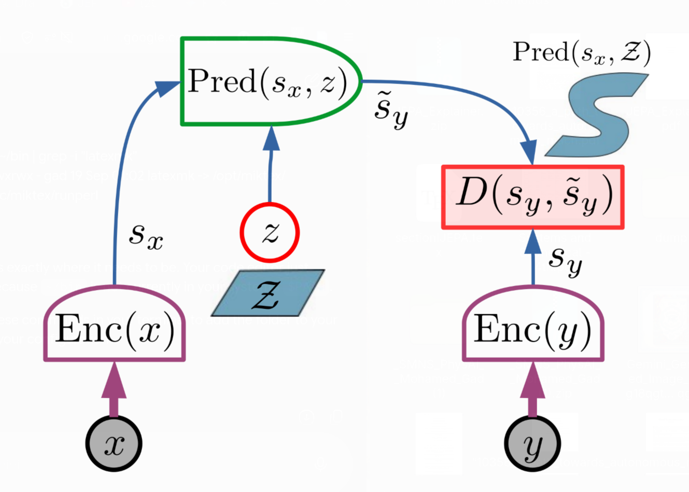
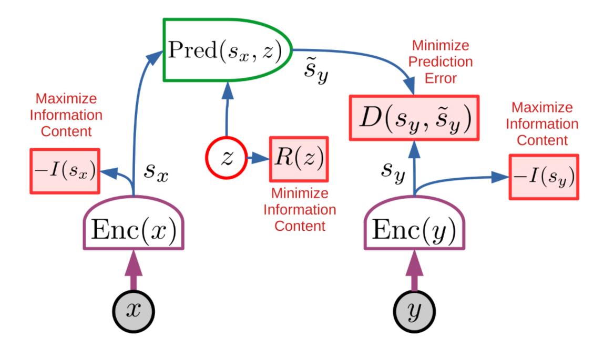
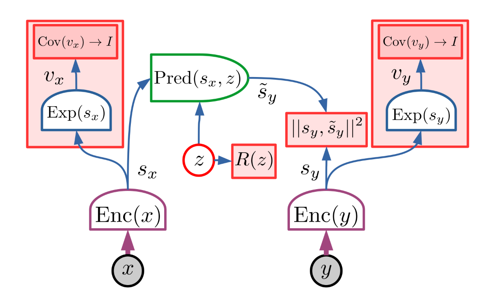

This is the first post in a series on the Joint Embedding Predictive Architecture (JEPA) family of models. Here we build the foundation: the abstract JEPA idea, the energy-based view behind it, and the training problem it has to solve. The follow-up posts look at how this abstract recipe is instantiated for images and video.

JEPA was proposed by Yann LeCun in his 2022 position paper [*A Path Towards Autonomous Machine Intelligence*](https://openreview.net/pdf?id=BZ5a1r-kVsf). The paper lays out a roadmap for building machines that learn how the world works, and JEPA is its proposed answer to the question of *how a world model should be trained*. Everything below follows that paper's formulation; the figures are taken from it.

  
<b>Table of Contents</b>

- [Motivation: Predicting What Is Predictable](#motivation-predicting-what-is-predictable)
- [From Energy-Based Models to JEPA](#from-energy-based-models-to-jepa)
  - [Inputs and outputs](#inputs-and-outputs)
- [Why Predict in Representation Space?](#why-predict-in-representation-space)
- [Representing Multiple Possible Futures](#representing-multiple-possible-futures)
  - [Multimodality through encoder invariance](#multimodality-through-encoder-invariance)
  - [Multimodality through a latent predictor](#multimodality-through-a-latent-predictor)
- [The Collapse Problem](#the-collapse-problem)
- [Contrastive Training](#contrastive-training)
  - [Margin-based contrastive loss](#margin-based-contrastive-loss)
  - [InfoNCE form](#infonce-form)
- [Why Contrastive Training Becomes Problematic](#why-contrastive-training-becomes-problematic)
- [Non-Contrastive JEPA Training](#non-contrastive-jepa-training)
  - [Criteria 1 and 2: preventing representational collapse](#criteria-1-and-2-preventing-representational-collapse)
  - [Criterion 3: predictability](#criterion-3-predictability)
  - [Criterion 4: limiting the latent variable](#criterion-4-limiting-the-latent-variable)
- [A Concrete Non-Contrastive Instantiation: VICReg](#a-concrete-non-contrastive-instantiation-vicreg)
  - [Variance constraint](#variance-constraint)
  - [Covariance constraint](#covariance-constraint)
  - [Prediction term](#prediction-term)
- [The JEPA Objective as a Trade-off](#the-jepa-objective-as-a-trade-off)
- [Summary](#summary)
- [References](#references)

# Motivation: Predicting What Is Predictable

A central difficulty in learning a predictive model of the physical world is that the future is generally not uniquely determined by the information available in the present. Even when the underlying dynamics are deterministic, the current observation may be incomplete; moreover, many future details may simply be unpredictable from the available context. A video of a car approaching an intersection, for example, may provide enough information to predict that the car will continue along the road, but not whether its driver will turn left or right. At the pixel level, even apparently simple future frames contain large amounts of effectively unpredictable information such as texture, illumination, and small-scale motion.

A direct pixel-space predictor therefore faces an undesirable objective: instead of learning the aspects of the world that are stable and predictable, it is forced to model every detail of the future observation.

The Joint Embedding Predictive Architecture (JEPA) instead predicts in representation space rather than observation space ($s\_x \longrightarrow s\_y$ rather than $x \longrightarrow y$). Given an observed context $x$ and target $y$, a JEPA encodes them into representations


$$
s_x = f_{\theta_x}(x), \qquad s_y = f_{\theta_y}(y),
$$


and learns a predictor $\tilde{s}\_y = P\_{\phi}(s\_x,z)$ mapping the context representation $s\_x$ to the target representation $s\_y$, where $z$ is an optional latent variable representing target information that cannot be inferred from $x$.

# From Energy-Based Models to JEPA

The JEPA formulation is most naturally understood as a particular energy-based model (EBM). An EBM defines a scalar-valued function $F\_{\theta}(x,y)$ whose value is low when $x$ and $y$ are compatible and high when they are incompatible. Importantly, an EBM does not require the scalar energy to be interpreted as the logarithm of a probability density.

For the JEPA, compatibility is evaluated indirectly through learned representations. The two observations are first mapped to $s\_x = f\_{\theta\_x}(x)$ and $s\_y = f\_{\theta\_y}(y)$, after which a predictor produces a candidate target representation $\tilde{s}\_y = P\_{\phi}(s\_x,z)$.

The energy associated with a particular latent variable $z$ is then defined as the discrepancy between the actual target representation and its prediction:


$$
E_{\theta,\phi}(x,y,z) = D\!\bigl(s_y,\, P_{\phi}(s_x,z)\bigr),
$$


where $D(\cdot,\cdot)$ is a distance or discrepancy function in representation space.

The latent variable is not observed in the training data. For a given pair $(x,y)$, its value can therefore be defined by minimizing the energy:


$$
\hat{z} = \arg\min_{z\in\mathcal{Z}} E_{\theta,\phi}(x,y,z) = \arg\min_{z\in\mathcal{Z}} D\!\bigl(s_y,\, P_{\phi}(s_x,z)\bigr).
$$


Substituting this inferred latent variable into the energy gives the energy of the pair $(x,y)$:


$$
F_{\theta,\phi}(x,y) = \min_{z\in\mathcal{Z}} E_{\theta,\phi}(x,y,z) = D\!\bigl(s_y,\, P_{\phi}(s_x,\hat{z})\bigr).
$$


Thus, the JEPA can be viewed as a latent-variable EBM whose compatibility function is evaluated entirely in representation space.

## Inputs and outputs

For the generic JEPA considered here:

| Component | Input | Output |
|---|---|---|
| Context encoder | $x$ | $s\_x$ |
| Target encoder | $y$ | $s\_y$ |
| Predictor | $(s\_x,z)$ | $\tilde{s}\_y$ |
| Energy | $(s\_y,\tilde{s}\_y)$ | scalar $E(x,y,z)$ |

The encoders are not required to have the same architecture or even to share parameters. Consequently, $x$ and $y$ may in principle belong to different modalities. The essential requirement is that the two encoders map them into representations for which compatibility can be evaluated.

# Why Predict in Representation Space?

The central advantage of JEPA follows directly from the change in prediction space. Suppose that one instead trains a predictor directly in observation space, $\hat{y} = G\_{\phi}(x,z)$. A conventional reconstruction objective would then require


$$
\mathcal{L}_{\mathrm{obs}} = D_y(y,\hat{y}).
$$


For high-dimensional observations, this requires the predictor to account for all dimensions of $y$, including dimensions whose future values cannot be inferred reliably from $x$.

JEPA instead introduces an encoder $s\_y=f\_{\theta\_y}(y)$ whose representation can discard information that is irrelevant to the predictive task. The loss is consequently


$$
\mathcal{L}_{\mathrm{JEPA}} = D_s\!\bigl(f_{\theta_y}(y),\, P_{\phi}(f_{\theta_x}(x),z)\bigr).
$$


This changes the optimization problem in an important way. The encoder is allowed to map several observations to the same representation whenever their differences are irrelevant to the predictive relationship being learned. Formally, if $y\_1 \neq y\_2$ but $f\_{\theta\_y}(y\_1)=f\_{\theta\_y}(y\_2)$, then $F(x,y\_1)=F(x,y\_2)$.

The energy therefore need not distinguish between observations that differ in unpredictable or task-irrelevant details. This gives the JEPA a natural mechanism for representing multimodal conditional relationships without requiring the model to explicitly generate every possible observation.

# Representing Multiple Possible Futures

The fact that a single $x$ can be compatible with multiple values of $y$ creates a fundamental difficulty for deterministic prediction. A predictor $\tilde{s}\_y=P\_{\phi}(s\_x)$ can produce only one representation for a given $s\_x$, whereas the actual conditional relationship may contain many plausible target states.

The JEPA formulation describes two mechanisms for representing this multimodality.

## Multimodality through encoder invariance

The first mechanism is invariance in the target representation. Suppose a set of target observations $\mathcal{Y}(s) = \{y\_1,y\_2,\ldots\}$ all represent different realizations of the same predictive state, and the target encoder satisfies


$$
f_{\theta_y}(y_i)=s_y \qquad \forall\, y_i\in\mathcal{Y}(s).
$$


All of these observations consequently receive the same energy for a given prediction:


$$
F(x,y_i) = D(s_y,P_{\phi}(s_x,z)).
$$


The encoder therefore induces an equivalence relation over the observation space: multiple observations can be considered equivalent whenever their differences are not represented.

This mechanism is especially important for video. The model does not have to represent every microscopic detail of a future frame if those details are not necessary for predicting the representation of the future state.

## Multimodality through a latent predictor

The second mechanism is an explicit latent variable. For a fixed context representation $s\_x$, let


$$
\mathcal{P}(s_x) = \bigl\{ P_{\phi}(s_x,z) \;:\; z\in\mathcal{Z} \bigr\}
$$


denote the set of representations reachable by varying $z$. The predictor can therefore represent multiple plausible target states:


$$
\tilde{s}_y^{(1)} = P_{\phi}(s_x,z_1), \qquad \tilde{s}_y^{(2)} = P_{\phi}(s_x,z_2), \qquad \ldots
$$


The latent variable encodes information necessary to specify the future that cannot be inferred from $x$ alone, such as whether a car approaching a fork follows the left or right branch.

Representation invariance and latent-variable prediction therefore represent two distinct mechanisms for handling multimodality (both illustrated in the figure above): the former collapses observational differences that the representation does not need to preserve, while the latter explicitly parameterizes alternative plausible outcomes.

In the car example, $s\_x$ and $s\_y$ might capture the position, orientation and velocity of the car before and after the fork, ignoring irrelevant details such as the trees bordering the road or the texture of the sidewalk (invariance). The latent variable $z$ then selects which branch the car takes.

# The Collapse Problem

Predicting in representation space introduces an optimization hazard absent from observation-space regression: the encoders must not discard all information. Consider the objective


$$
\mathcal{L} = D\!\bigl(f_{\theta_y}(y),\, P_{\phi}(f_{\theta_x}(x),z)\bigr).
$$


A trivial minimizer occurs when both encoders collapse to a constant, $f\_{\theta\_x}(x)=c$ and $f\_{\theta\_y}(y)=c$ for all $x,y$. If the predictor simply outputs $P\_{\phi}(c,z)=c$, the loss is identically zero ($\mathcal{L}=D(c,c)=0$) without learning any useful structure.

More generally, partial collapse occurs if the encoders retain negligible information and become invariant over excessively large regions of input space, making the energy surface nearly flat. Minimizing prediction error alone is therefore insufficient; a viable training objective must balance two opposing pressures:

1. *informativeness*: representations must preserve sufficient information about their inputs;
2. *predictability*: the target representation must be predictable from the context representation.

# Contrastive Training

A JEPA can be trained as a conventional energy-based model using contrastive learning. For a positive pair $(x,y)$, define the positive energy $F^+ = F\_{\theta}(x,y)$. Construct one or more incompatible target samples $\hat{y}\_1,\ldots,\hat{y}\_K$ and compute their corresponding energies $F\_k^- = F\_{\theta}(x,\hat{y}\_k)$. The desired energy ordering is


$$
F_{\theta}(x,y) < F_{\theta}(x,\hat{y}_k), \qquad k=1,\ldots,K.
$$


A generic contrastive loss can consequently be written as


$$
\mathcal{L} = H\bigl(F_{\theta}(x,y),\, F_{\theta}(x,\hat{y}_1),\, \ldots,\, F_{\theta}(x,\hat{y}_K)\bigr),
$$


where $H$ increases as the positive energy increases and decreases as the negative energies increase.

## Margin-based contrastive loss

One simple formulation is the distance-dependent hinge loss:


$$
\mathcal{L}_{\mathrm{hinge}} = \bigl[ F_{\theta}(x,y) - F_{\theta}(x,\hat{y}) + m(y,\hat{y}) \bigr]_+,
$$


where $[a]\_+ = \max(a,0)$ and, in the formulation proposed by LeCun, the margin grows with the distance between the samples:


$$
m(y,\hat{y}) = \mu \left\| y-\hat{y} \right\|_2^2.
$$


The loss is zero whenever the negative energy is sufficiently larger than the positive energy:


$$
F_{\theta}(x,\hat{y}) \geq F_{\theta}(x,y)+m(y,\hat{y}).
$$


## InfoNCE form

With multiple negative samples, the EBM discussion in LeCun's paper gives an InfoNCE-style energy objective:


$$
\mathcal{L}_{\mathrm{InfoNCE}} = F_{\theta}(x,y) + \log\bigl( \exp\bigl[-F_{\theta}(x,y)\bigr] + \sum_{k=1}^{K} \exp\bigl[-F_{\theta}(x,\hat{y}_k)\bigr] \bigr).
$$


The logarithmic term ensures that reducing the positive energy is not sufficient: the model must also assign relatively higher energies to the contrastive samples.

# Why Contrastive Training Becomes Problematic

Contrastive training solves collapse by explicitly specifying where the energy should be raised. This creates a fundamental sampling problem. For each context $x$, the model is trained to establish an energy landscape in the target representation space such that the observed compatible target has lower energy than an incompatible one:


$$
F(x,y) < F(x,\hat{y}).
$$


However, increasing the energy at a finite collection of contrastive points does not constrain the energy elsewhere. If the target representation $s\_y\in\mathbb{R}^{d}$ has high dimension, a flexible energy function can potentially remain low in substantial portions of the representation space that have never been sampled as negatives.

Consequently, successful contrastive training requires sufficiently broad coverage of the negative space. LeCun identifies two practical problems:

1. a mechanism is required for generating or selecting suitable contrastive samples;
2. the number of contrastive samples needed to constrain a high-dimensional energy surface can grow very rapidly with representation dimensionality.

In the worst case, the required number of samples can grow exponentially with the dimensionality of the representation. Thus, although contrastive learning is a valid way of preventing collapse, its computational cost is coupled to the dimensionality of the representation.

This observation motivates the alternative that is particularly important to JEPA: *non-contrastive, regularized training*.

# Non-Contrastive JEPA Training

Rather than explicitly sampling points whose energy should be high, non-contrastive training attempts to control the geometry and information content of the representation itself. LeCun identifies four criteria:

1. maximize the information content of $s\_x$ about $x$;
2. maximize the information content of $s\_y$ about $y$;
3. minimize the representation prediction error;
4. minimize the information content of the latent variable $z$.

The resulting conceptual objective can be written schematically as


$$
\mathcal{L}_{\mathrm{JEPA}} = \underbrace{\mathcal{L}_{\mathrm{pred}}}_{\text{predictability}} + \lambda_x \underbrace{\mathcal{R}_x}_{\text{information}} + \lambda_y \underbrace{\mathcal{R}_y}_{\text{information}} + \lambda_z \underbrace{\mathcal{R}_z}_{\text{latent info}},
$$


where


$$
\mathcal{L}_{\mathrm{pred}} = D\!\bigl(s_y,\, P_{\phi}(s_x,z)\bigr).
$$


The important point is that the original JEPA proposal does *not* specify one universal closed-form non-contrastive loss. Instead, it specifies these four information-theoretic requirements and identifies methods such as VICReg and Barlow Twins as possible concrete mechanisms for satisfying them.

## Criteria 1 and 2: preventing representational collapse

The first two criteria require the representations to remain informative: $s\_x = f\_{\theta\_x}(x)$ should preserve information about $x$, while $s\_y = f\_{\theta\_y}(y)$ should preserve information about $y$. Without these constraints, the optimization can reduce the prediction error by making the representations constant: $s\_x=s\_y=c$.

Thus, information-preserving regularization serves the same conceptual role as negative samples in contrastive learning: preventing the energy surface from becoming uniformly low. Whereas contrastive methods explicitly raise the energy of sampled negatives, non-contrastive methods directly constrain the geometry and variance of the representations.

## Criterion 3: predictability

The third criterion is supplied directly by the JEPA energy:


$$
\mathcal{L}_{\mathrm{pred}} = D(s_y,\tilde{s}_y).
$$


Information in $s\_y$ that cannot be predicted from $s\_x$ directly inflates this error. Consequently, the optimization balances retaining input information against retaining only what is predictable from context.

## Criterion 4: limiting the latent variable

The latent variable introduces a second collapse mechanism. Consider $\tilde{s}\_y=P\_{\phi}(s\_x,z)$ and suppose that $z$ has at least as much capacity as $s\_y$. A sufficiently expressive predictor could simply ignore $s\_x$ and learn $P\_{\phi}(s\_x,z)=z$. For any target representation $s\_y$, one could then select $\hat{z}=s\_y$, giving


$$
D(s_y,P_{\phi}(s_x,\hat{z})) = D(s_y,s_y) = 0.
$$


The model can therefore obtain zero prediction error without learning a meaningful dependency between $x$ and $y$. The latent variable must consequently have limited information capacity. Possible constraints include:

- discrete latent variables;
- low-dimensional latent variables;
- sparse latent variables;
- noisy or stochastic latent variables.

For example, if $z$ takes only $K$ discrete values, then for a fixed $s\_x$ the predictor can produce at most $K$ zero-error predictions:


$$
\bigl\{ P_{\phi}(s_x,0),\, P_{\phi}(s_x,1),\, \ldots,\, P_{\phi}(s_x,K-1) \bigr\}.
$$


If instead $z\in\mathbb{R}^d$ with $d < \dim(s\_y)$, then, assuming a smooth predictor, the set $\{P\_{\phi}(s\_x,z):z\in\mathbb{R}^d\}$ is at most a $d$-dimensional manifold embedded in the higher-dimensional space of $s\_y$.

Thus, limiting the latent capacity directly limits the volume of target representation space that can be assigned low energy.

# A Concrete Non-Contrastive Instantiation: VICReg

LeCun's paper uses VICReg (Variance-Invariance-Covariance Regularization) as an example of how its abstract information-preservation criteria can be implemented in a differentiable training objective. The central idea is to prevent individual representation dimensions from becoming constant while also discouraging redundancy between dimensions.

Let


$$
v_x=g_{\psi}(s_x), \qquad v_y=g_{\psi}(s_y)
$$


be higher-dimensional embeddings obtained by an optional trainable "expander" network. Given a batch of $B$ samples, let $V\in\mathbb{R}^{B\times d}$ denote the resulting representation matrix.

## Variance constraint

For each representation dimension $j$, VICReg imposes a lower bound on its batch standard deviation:


$$
\begin{array}{c} \sigma_j = \sqrt{ \frac{1}{B} \sum_{i=1}^{B} \bigl( V_{ij}-\bar V_j \bigr)^2 +\epsilon }. \end{array}
$$


A hinge-style variance penalty can then be written as


$$
\mathcal{L}_{\mathrm{var}} = \frac{1}{d} \sum_{j=1}^{d} \max(0,\gamma-\sigma_j),
$$


where $\gamma$ is a prescribed minimum standard deviation. This term makes a constant representation dimension expensive. In particular, if $V\_{1j}=V\_{2j}=\cdots=V\_{Bj}$, then $\sigma\_j \approx 0$ and the variance penalty is positive.

## Covariance constraint

Variance alone does not prevent all dimensions from encoding the same information. Let


$$
C = \frac{1}{B-1} (V-\bar V)^{\top}(V-\bar V)
$$


be the empirical covariance matrix. VICReg penalizes the off-diagonal elements:


$$
\mathcal{L}_{\mathrm{cov}} = \frac{1}{d} \sum_{i\neq j} C_{ij}^{2}.
$$


The preferred covariance structure is therefore approximately diagonal, $C \approx \operatorname{diag}(\sigma\_1^2,\ldots,\sigma\_d^2)$, so the representation is encouraged to use its dimensions non-redundantly.

## Prediction term

The JEPA prediction criterion supplies the invariance/predictability term, $\mathcal{L}\_{\mathrm{pred}} = D(s\_y,\tilde{s}\_y)$. For the simplest invariant formulation, $x$ and $y$ are two different views of the same underlying content, the predictor is the identity, $\tilde{s}\_y=s\_x$, and


$$
\mathcal{L}_{\mathrm{pred}} = \|s_x-s_y\|_2^2.
$$


The full VICReg-style objective can then be written schematically as


$$
\mathcal{L}_{\mathrm{VICReg}} = \lambda_{\mathrm{inv}}\mathcal{L}_{\mathrm{pred}} + \lambda_{\mathrm{var}}\mathcal{L}_{\mathrm{var}} + \lambda_{\mathrm{cov}}\mathcal{L}_{\mathrm{cov}}.
$$


This is an important conceptual transition. Contrastive methods prevent collapse by making representations of *different samples* dissimilar. VICReg instead prevents collapse by making the *dimensions of the representation* non-degenerate and non-redundant. LeCun consequently describes VICReg as effectively "contrastive over dimensions" rather than over samples.

# The JEPA Objective as a Trade-off

The resulting optimization balances three requirements: informativeness ($s\_x$ must retain information about $x$), predictability ($s\_y$ must be predictable from $s\_x$), and non-degeneracy ($s\_x, s\_y$ must avoid collapse).

Crucially, the representation should not simply maximize raw mutual information. An invertible encoder $s\_y = f\_{\theta\_y}(y)$ preserves all information in $y$, but retains unpredictable noise and small-scale variations that cannot be inferred from $x$. Instead, JEPA seeks a representation that compresses the data manifold along directions of unpredictable variation while remaining sufficiently non-degenerate along directions needed to distinguish predictable states.

# Summary

A generic JEPA can be summarized by the following computational graph:


$$
\hbox{$x \xrightarrow{\;f_{\theta_x}\;} s_x \xrightarrow{\;P_{\phi}(\cdot,z)\;} \tilde{s}_y \quad\longleftrightarrow\quad s_y \xleftarrow{\;f_{\theta_y}\;} y$.}
$$


The prediction error $D(s\_y,\tilde{s}\_y)$ defines the energy, while regularization or contrastive training determines how the energy landscape is prevented from collapsing. The essential properties are:

1. **Prediction occurs in representation space rather than observation space.**
2. **The target representation may discard unpredictable or irrelevant details.**
3. **Multiple compatible targets can be represented through encoder invariance or latent-variable prediction.**
4. **Prediction error alone is insufficient because the representation can collapse.**
5. **Contrastive training prevents collapse by explicitly raising the energy of negative samples.**
6. **Non-contrastive training instead constrains the information content and geometry of the representations.**
7. **When a latent variable is used, its information capacity must itself be restricted.**

These principles define the abstract JEPA. The rest of this series asks a more specific question: *how should this abstract architecture and objective be instantiated for high-dimensional images and, eventually, spatiotemporal video?* The next posts take on that question, starting with image-based JEPAs.

# References

- LeCun, Y. (2022). [*A Path Towards Autonomous Machine Intelligence*](https://openreview.net/pdf?id=BZ5a1r-kVsf). OpenReview position paper, version 0.9.2.
